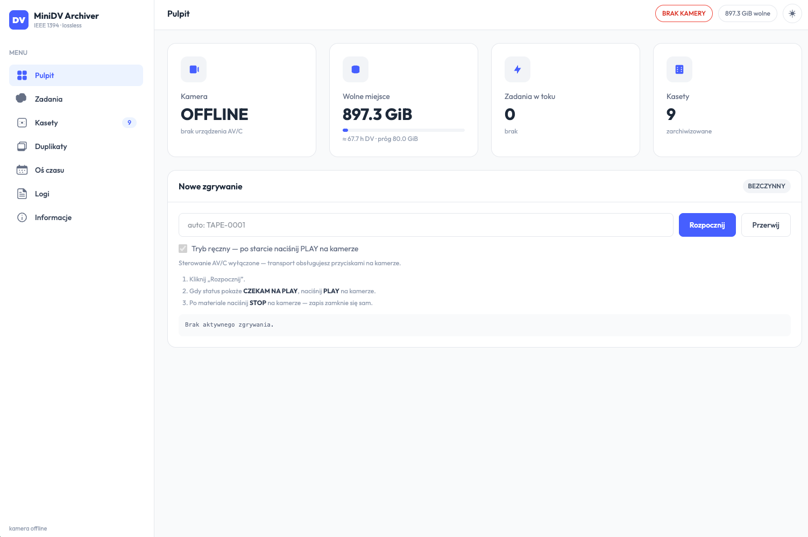
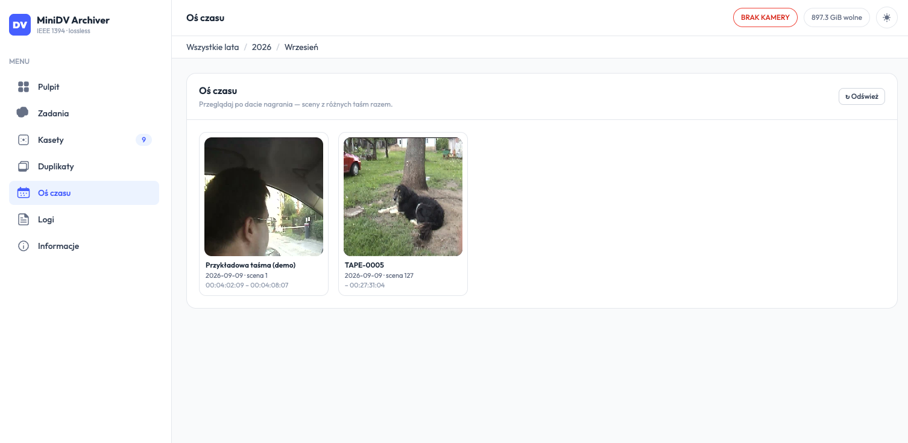

# MiniDV Archiver

[English](README.md) · **Polski**

[](LICENSE)


**Ocal rodzinne kasety MiniDV co do bitu, a potem naprawdę coś w nich znajdź.**

Podłączasz kamerę przez FireWire i klikasz *Rozpocznij*. Każda kaseta staje się
zweryfikowanym, bajt w bajt wiernym archiwum podzielonym na sceny. Przeglądasz je potem
jak Zdjęcia w telefonie:
- oś czasu rok → miesiąc;
- widok Osoby, który rozpoznaje twarze;
- eksport jednym kliknięciem, do wysłania rodzinie albo do naprawy starego obrazu.

Wszystko działa na Twoim własnym Linuksie, bez chmury.



<table>
<tr>
<td width="50%"></td>
<td>

**W skrócie**

- 🎞️ **Bezstratne zgrywanie**: surowy strumień DV, skompresowany zstd i sprawdzony
  bajt po bajcie
- ✂️ **Automatyczny podział na sceny** z datą i godziną nagrania odczytaną z taśmy
- 🗓️ **Oś czasu** według daty nagrania, ze wszystkich kaset naraz
- 🧑‍🤝‍🧑 **Osoby**: rozpoznawanie twarzy na Twoim komputerze. Podpisujesz twarz i
  widzisz każde nagranie z tą osobą
- 🧹 **Naprawa**: usuwanie przeplotu, odszumianie, usuwanie bloków, opcjonalnie
  stabilizacja i wyższa rozdzielczość
- ⬇️ **Udostępnianie**: MP4 ~90 MB na Messengera, jeden film z wielu kaset albo ZIP
- 🐳 **Jedno `docker compose up`**: cztery małe usługi, interfejs PL / EN

</td>
</tr>
</table>

---

**Spis treści:** [Funkcje](#funkcje) · [Szybki start](#szybki-start-docker) ·
[Wymagania](#wymagania) · [Konfiguracja](#konfiguracja) · [Użycie](#użycie) ·
[API](#api) · [FireWire](#kompatybilność-kamer-i-uwagi-o-firewire) ·
[Rozwój](#rozwój)

## Funkcje

### 🎞️ Zgrywanie: włączasz i idziesz

- **Działa z każdą kamerą i magnetowidem MiniDV z AV/C** (przez `dvgrab`). Sterowanie
  jest automatyczne (przewijanie, PLAY i STOP przez AV/C) albo w pełni ręczne, dla kamer,
  które źle znoszą AV/C.
- **Mądre wykrywanie końca taśmy.** Przetrzymuje puste fragmenty i zaniki sygnału:
  ponownie uruchamia `dvgrab` i bezstratnie skleja kawałki. Kończy krótko po tym, jak
  nagranie naprawdę się skończy.
- **Podgląd na żywo** w trakcie zgrywania, z czasem taśmy i liczbą zgranych bajtów.
- **Praca potokowa.** Zgrywanie zajmuje port FireWire, a dzielenie, kompresja i
  kodowanie idą w kolejce w tle, więc od razu możesz wkładać następną kasetę.
  Przetwarzanie pokazuje postęp scena po scenie i przewidywany czas.
- **Strefa czasowa zegara kamery dla każdego zgrywania.** Data z taśmy DV nie ma strefy.
  Wybierasz, na jaką strefę był ustawiony zegar (np. wakacje za granicą), i każdy
  `creation_time` wskazuje właściwy moment.
- **Workspace'y.** Kasety różnych osób czy rodzin się nie mieszają: każdy workspace ma
  własne kasety, oś czasu, duplikaty i osoby.

### 🔒 Archiwum: master, któremu zaufasz za 30 lat

- **Masterem jest surowe DV.** Dla każdej sceny: `sha256` → `zstd` → `zstd -t` →
  dekompresja strumieniowa → porównanie. Oryginalny `.dv` znika dopiero wtedy, gdy
  `.dv.zst` odtwarza go dokładnie.
- **Pochodne, które zawsze odtworzysz**:
  - proxy H.264/AAC dla każdej sceny;
  - jeden ciągły `tape.mp4`;
  - miniatury;
  - szczegółowy JSON sceny (timecode, data nagrania z VAUX, przeplot, układ audio,
    zgubione klatki).
- **Pliki pamiętają swoje pochodzenie.** MP4 mają `creation_time`, tytuł i komentarz z
  taśmy. *📅 Uzupełnij datę nagrania* dopisuje je do starszych plików.
- **`sha256sum -c tape.sha256`** sprawdza cały katalog kasety. Format jest opisany w
  [`docs/ARCHIVE_FORMAT.md`](docs/ARCHIVE_FORMAT.md).
- **Taśma jest tylko do odczytu.** Polecenie `RECORD` nigdy nie jest wysyłane.

### 🗓️ Przeglądanie: jak Zdjęcia, nie jak foldery

- **Oś czasu**: rok → miesiąc → scena. Sceny z różnych kaset nagrane tego samego dnia
  układają się według faktycznej godziny nagrania.
- **Kasety**: siatka albumów, karty scen, podgląd w oknie, odtwarzanie całej taśmy z
  rozdziałami do przewijania kliknięciem.
- **Lista albo kafelki.** Kliknięcie kafelka otwiera pełnoekranowy podgląd z
  przesuwaniem palcem i strzałkami.
- **Porządki z poziomu UI**: zmiana nazwy kaset, etykiety, daty nagrania, usuwanie scen
  i kaset. Długie operacje idą w tle.
- **Duplikaty.** Sonda jakości liczy błędy dekodowania i robi odcisk każdej sceny. Widok
  *Duplikaty* grupuje to samo nagranie z osobnych zgrań jednej kasety, wskazuje
  najczystszą wersję i ma przycisk *✓ Zostaw najlepsze we wszystkich grupach*. Fałszywe
  dopasowania odrzucasz przyciskiem *✕ To nie duplikat*.

### 🧑‍🤝‍🧑 Osoby: rozpoznawanie twarzy, które nie opuszcza Twojego komputera

- **Podpisz twarz raz, a strona osoby pokaże każde nagranie, w którym się pojawia.**
  Przyciski typu **▶ 0:12–0:20** startują odtwarzanie dokładnie w chwili, gdy ją widać.
- **Edycja jak w telefonie**:
  - nadanie imienia, które już istnieje, łączy dwie osoby;
  - *⇄ To ta sama osoba co…* łączy przez wybór z listy;
  - **✕** przy twarzy oznacza „to nie ta osoba”;
  - obcych można ukryć.
- **Dwa etapy.**
  1. Szybki skan nowych scen (OpenCV YuNet + SFace). Z każdej sekundy nagrania
     analizuje pierwszą nierozmazaną klatkę.
  2. Dokładna analiza wraca do każdej znalezionej twarzy, ocenia ujęcia (przodem, ostre,
     duże) i najlepsze z nich przepuszcza przez ArcFace. Potem grupuje wszystkich od
     nowa:
     - dwie twarze z jednej klatki to nigdy ta sama osoba;
     - twarze z profilu lub rozmazane dołączają tylko przy wyraźnym dopasowaniu;
     - **Twoje połączenia, odłączenia i imiona są twardymi regułami**, których
       przeliczenie nie złamie.
- **Szanuje komputer, na którym działa.**
  - Skanuje co noc o 3:00 albo na żądanie, zawsze jeden skan naraz.
  - Widać go w *Zadaniach* z paskiem postępu i przewidywanym czasem, można go przerwać.
  - Na czas zgrywania i przetwarzania się wstrzymuje. Działa na jednym rdzeniu z
    najniższym priorytetem i wznawia od miejsca przerwania.
  - Na czterordzeniowym i7 z 2017 roku szybki etap idzie około 10× szybciej niż czas
    rzeczywisty.
- **Osobno dla każdego workspace'u.** Twarze z różnych workspace'ów nigdy nie są ze sobą
  porównywane.

### 🧹 Naprawa i ⬇️ udostępnianie

- **🧹 Napraw** buduje oczyszczone MP4 **dekodowane z mastera DV**, nie z proxy:
  - usuwanie przeplotu `bwdif` z wykrytą kolejnością pól;
  - `atadenoise` i `deblock` (cały łańcuch filtrów da się skonfigurować);
  - opcjonalnie **stabilizacja** (dwuprzebiegowy `libvidstab`);
  - opcjonalnie **wyższa rozdzielczość**: upscaler `libplacebo` z ffmpeg przez Vulkan,
    wymaga GPU w `/dev/dri`.
- **⬇ FB** koduje scenę, zaznaczenie albo całą taśmę do MP4 ~90 MB w tej samej
  rozdzielczości, na Messengera lub Facebooka.
- **🎬 Zbuduj jeden film** ze scen wybranych z różnych kaset, prosto z osi czasu: jako
  bezstratne sklejenie albo naprawione z masterów.
- **📦 ZIP** pobiera zaznaczone sceny jako osobne pliki.
- **Master i proxy nigdy nie są modyfikowane.** Wyniki są tymczasowe i same się
  sprzątają.

### 🐳 Utrzymanie

- **Cztery kontenery albo jeden proces.**
  - **`grabber`** obsługuje FireWire.
  - **`converter`** robi przetwarzanie, re-enkodowanie i skan twarzy.
  - **`api`** serwuje HTTP/JSON.
  - **`ui`** to nginx z interfejsem.

  Koordynują się przez mały magazyn zadań SQLite, więc api można zrestartować, a
  converter przenieść na inną maszynę w trakcie zgrywania. Zob.
  [`docs/ARCHITECTURE.md`](docs/ARCHITECTURE.md).
- **Odporne na awarie.** Po restarcie przerwane przetwarzanie wraca do kolejki z
  surowego DV.
- **Pulpit**: obciążenie serwera (CPU, pamięć, swap), wolne miejsce z szacunkiem, ile
  godzin DV jeszcze się zmieści, i status kamery.
- **Opcjonalne logowanie HTTP basic auth** dla wystawienia do internetu. Domyślnie jest
  wyłączone, więc świeży klon działa od razu w sieci lokalnej.

## Szybki start (Docker)

```bash
git clone https://github.com/tomek10861/MiniDV-Archiver
cd MiniDV-Archiver
cp .env.example .env          # opcjonalnie; np. MINIDV_ALLOW_FCP=0 dla Sony DCR-PC2E
sudo mkdir -p /srv/minidv
docker compose up -d --build
# UI pod http://<host>:8088
```

Cztery kontenery współdzielą `/srv/minidv` (i jego `state/jobs.db`):

| usługa | kontener | robi |
|---|---|---|
| `grabber` | `privileged`, `/dev` + `/sys` hosta | trzyma FireWire, uruchamia `dvgrab` |
| `converter` | — | podział na sceny, zstd + weryfikacja bajtowa, proxy, re-enkodowanie, sondy jakości, rozpoznawanie twarzy |
| `api` | `expose: 8080` (niepublikowany) | HTTP/JSON; czyta system plików + magazyn zadań |
| `ui` | `nginx`, publikuje `:8088` | serwuje `frontend/`, przekazuje `/api` → `api:8080` |

Każdą usługę można zrestartować bez ruszania pozostałych
(`docker compose restart api`).

Port publikuje tylko `ui`, a **domyślnie nie ma logowania**. Albo trzymaj `:8088` za
zaporą w zaufanej sieci lokalnej, albo włącz basic auth przy wystawieniu do internetu
(np. przez Cloudflare Tunnel), zob. [`docker/.htpasswd.example`](docker/.htpasswd.example).

`grabber` jest `privileged`, bo węzeł `/dev/fw*` kamery pojawia się dynamicznie. On, api
i converter montują też `/sys` hosta tylko do odczytu, żeby `camera.info()` mogło
znaleźć węzeł FireWire.

### Inne sposoby uruchomienia

```bash
sudo ./scripts/install.sh            # systemd, jeden proces na :8080
sudo ./scripts/install.sh --split    # systemd, grabber + converter + api + nginx bez Dockera
MINIDV_STORAGE=$HOME/minidv python3 -m minidv_archiver.server   # bez instalacji, jeden proces
```

`scripts/install.sh`:
- kopiuje aplikację do `/opt/minidv-archive`;
- instaluje regułę udev (`systemd/99-minidv-firewire.rules`) i jednostki systemd;
- uruchamia je.

Konfiguracja trafia do `/etc/minidv-archive.env`.

## Wymagania

Host to zawsze **Linux ze stosem jądra `firewire_ohci` / `firewire_core`** i działającym
kontrolerem OHCI 1394 (`/dev/fw*`). Do tego kamera albo magnetowid MiniDV z portem
DV/i.LINK, przełączony w tryb **PLAYER / VCR**.

- **Docker** (zalecane): Docker Engine + Compose. Wszystko jest w obrazie:
  - `dvgrab`, `ffmpeg`, `zstd`, `linux-firewire-utils`;
  - OpenCV, onnxruntime i modele twarzy (~210 MB, sumy kontrolne sprawdzane przy
    budowaniu).
- **Bez Dockera**: Python **3.11+** i te narzędzia w `PATH`:

  ```bash
  sudo apt install dvgrab ffmpeg zstd linux-firewire-utils util-linux python3
  pip install ".[faces]"       # opcjonalnie: Osoby / rozpoznawanie twarzy
  ```

  Rdzeń korzysta tylko z biblioteki standardowej Pythona. Bez dodatku `faces` widok
  Osoby po prostu pokazuje, że rozpoznawanie jest niedostępne.

## Konfiguracja

Wszystko ustawiasz zmiennymi środowiskowymi: w `.env` przy Dockerze albo w
`/etc/minidv-archive.env` przy systemd. Pełna lista z wartościami domyślnymi jest w
[`.env.example`](.env.example). Najczęściej zmieniane:

| Zmienna | Domyślnie | Znaczenie |
|---|---|---|
| `MINIDV_STORAGE` | `/srv/minidv` | katalog archiwum (montowany do każdego kontenera) |
| `MINIDV_CAMERA_GUID` | *(auto)* | puste = pierwsze urządzenie taśmowe AV/C na magistrali |
| `MINIDV_ALLOW_FCP` | `1` | `1` = sterowanie przez AV/C; `0` = ręczne PLAY/STOP na kamerze |
| `MINIDV_MP4_PRESET` | `medium` | preset x264 dla proxy (`veryfast` ~4–6× szybciej, większe pliki) |
| `MINIDV_DEFAULT_RECORDING_TZ` | `Europe/Warsaw` | strefa zegara kamery, do zamiany daty z DV na prawdziwy `creation_time`; nadpisywalna przy zgrywaniu |
| `MINIDV_SHARE_MAX_MB` | `90` | docelowy rozmiar pliku „udostępnij” |
| `MINIDV_RESTORE_FILTERS` | `bwdif…,atadenoise,deblock…` | łańcuch `-vf` ffmpeg dla „napraw” |
| `MINIDV_STABILIZE_SHAKINESS` / `_SMOOTHING` | `8` / `20` | siła vidstab dla opcji *Stabilizacja* |
| `MINIDV_UPSCALE_FACTOR` / `_SCALER` | `2` / `ewa_lanczos4sharpest` | opcja *Wyższa rozdzielczość* |
| `MINIDV_FACES` | `1` | `0` wyłącza rozpoznawanie twarzy |
| `MINIDV_FACES_SCAN_AT` | `03:00` | codzienny skan nowych scen (czas lokalny); puste = tylko ręcznie |
| `MINIDV_FACES_THREADS` | `1` | wątki CPU dla skanu twarzy (`2` ≈ dwa razy szybciej) |
| `MINIDV_FACES_CLUSTER` | `0.24` | jak chętnie łączyć twarze (niżej = mniej rozbitych osób, więcej pomieszanych) |
| `MINIDV_INDEX_INTERVAL` | `300` | co ile sekund odświeżać indeks kaset/scen w tle |
| `MINIDV_BIND` / `MINIDV_PORT` | `0.0.0.0` / `8080` | nasłuch HTTP api (wewnątrz kontenera) |

## Użycie

1. Włóż kasetę, przełącz kamerę na **PLAYER / VCR** i podłącz FireWire (najpierw
   przeczytaj [ostrzeżenie o kablach](#kompatybilność-kamer-i-uwagi-o-firewire)).
2. Otwórz pulpit (`:8088` z Dockerem, `:8080` w trybie jednego procesu). Opcjonalnie
   wybierz **workspace** i **strefę czasową zegara kamery**, potem **Nowe zgrywanie** →
   *Rozpocznij*. Identyfikator kasety nada się sam, np. `TAPE-0001`.
3. **Tryb automatyczny** (`MINIDV_ALLOW_FCP=1`): program sam przewinie i włączy PLAY.
   **Tryb ręczny**: poczekaj na `CZEKAM NA PLAY`, naciśnij **PLAY** na kamerze, a na końcu
   materiału **STOP**. Możesz też poczekać, aż zatrzyma się sam po pustym końcu taśmy.
4. Zgrywanie przechodzi do przetwarzania w tle, więc możesz od razu wkładać następną
   kasetę. Wyniki są w **Kasetach**, na **Osi czasu** i w **Osobach**, a praca w tle w
   **Zadaniach**.

### CLI

```bash
python3 -m minidv_archiver.cli camera status        # transport AV/C + timecode
python3 -m minidv_archiver.cli camera play|stop     # tylko przy MINIDV_ALLOW_FCP=1
python3 -m minidv_archiver.cli process take.dv --tape-id TAPE-0007   # wczytaj istniejący .dv
python3 -m minidv_archiver.cli serve                # jeden proces (zgrywanie + converter + api)
python3 -m minidv_archiver.cli grabber              # podział: tylko zgrywanie FireWire
python3 -m minidv_archiver.cli converter            # podział: przetwarzanie w tle
python3 -m minidv_archiver.cli api                  # podział: tylko HTTP/JSON
```

### Weryfikacja i odtworzenie mastera

```bash
zstd -t 0001_*.dv.zst                       # integralność archiwum
zstd -dc 0001_*.dv.zst > recovered.dv       # dokładnie surowe DV z powrotem
sha256sum -c tape.sha256                    # każdy plik w katalogu kasety
```

[`examples/demo-tape/`](examples/demo-tape/) zawiera kompletne przykładowe archiwum:
jedną prawdziwą scenę ~6 s, ~20 MB. Skopiuj je do `$MINIDV_STORAGE/tapes/`, żeby
zobaczyć je w pulpicie.

## API

JSON przez HTTP, serwowany przez proces `api` (`nginx` przekazuje do niego `/api`).
Każdy endpoint listy przyjmuje `?workspace=<nazwa>`, domyślnie `"default"`. Długie
zadania (re-enkodowanie, usuwanie scen, skany) zwracają `202`, a ich stan sprawdzasz,
powtarzając to samo wywołanie, aż przejdzie przez `QUEUED` → `RUNNING` → `READY`.
Pełna lista endpointów (po angielsku) jest w [README.md](README.md#api).

## Kompatybilność kamer i uwagi o FireWire

> **⚠ Kable: przejściówka 6-pin ↔ 4-pin potrafi spalić port.** 6-pinowe złącze FireWire
> przenosi zasilanie magistrali (~8–30 V), a 4-pinowe i.LINK nie. Tania lub źle zrobiona
> przejściówka, albo podłączanie na gorąco, może wpuścić napięcie do portu, który nie
> jest na to przygotowany, i **spalić złącze FireWire kamery albo komputera**. Tak
> właśnie skończyła tu jedna stara kamera.
>
> - **Komputer wyłączony** → najpierw wepnij końcówkę **6-pin** do komputera.
> - **Kamera wyłączona** → wepnij końcówkę **4-pin** do kamery.
> - Dopiero wtedy włącz oba urządzenia. **Nigdy nie podłączaj żadnego końca na gorąco.**
> - Jeśli karta w komputerze ma port 4-pin, użyj zwykłego kabla **4-pin ↔ 4-pin** albo
>   sprawdzonej przejściówki.

Większość magnetowidów i kamer DV dobrze działa przez AV/C. Niektóre starsze układy
i.LINK są na granicy: wypadają z magistrali albo resetują ją przy transakcjach FCP.
Jeśli trafisz na taki:

- Ustaw `MINIDV_ALLOW_FCP=0` i steruj PLAY/STOP ręcznie.
- Odłącz kamerze zasilacz na 30–60 s, żeby odblokować zawieszony układ. Programowo
  się tego nie da zrobić.
- Wyłącz zarządzanie energią (runtime PM) dla kontrolera FireWire i ewentualnego mostka
  PCIe–PCI (`ATTR{power/control}="on"`). `systemd/99-minidv-firewire.rules` ma przykład
  dla VIA VT6306 + ASMedia ASM1083.

**Sony DCR-PC2E** to przykład wszystkich powyższych problemów naraz; zob.
[`docs/FIREWIRE.md`](docs/FIREWIRE.md).

Więcej dokumentacji (po angielsku): [architektura](docs/ARCHITECTURE.md) ·
[format archiwum](docs/ARCHIVE_FORMAT.md) · [metadane DV](docs/DV_METADATA.md) ·
[przechowywanie](docs/STORAGE.md).

## Rozwój

```bash
python3 -m pip install -e ".[dev,faces]"
python3 -m pytest -q
```

Aplikacja steruje `dvgrab`, `ffmpeg` i `zstd` jako podprocesami. Tylko rozpoznawanie
twarzy ma zależności Pythona (OpenCV, numpy, onnxruntime), a jego testy bez nich same się
pomijają. Po zmianie kodu przebuduj obraz: `docker compose up -d --build`.

Frontend to zwykły JavaScript bez kroku budowania: `frontend/index.html`,
`frontend/app.js` i `frontend/i18n.js` (angielski/polski), ostylowany dołączonym CSS
TailAdmin. Po zmianie znaczników lub klas przebuduj CSS:

```bash
scripts/build-css.sh          # wymaga Node + npm; nadpisuje frontend/vendor/tailadmin.css
```

## Licencja

MIT; zob. [LICENSE](LICENSE).

Dołączone i pobierane elementy zewnętrzne mają własne licencje:
- TailAdmin i Alpine.js: MIT;
- modele YuNet i SFace z OpenCV Zoo: MIT / Apache-2.0;
- wagi ArcFace (insightface `buffalo_l`): **wyłącznie do użytku niekomercyjnego**. Dla
  rodzinnego archiwum to w porządku; przed użyciem komercyjnym trzeba to sprawdzić.
